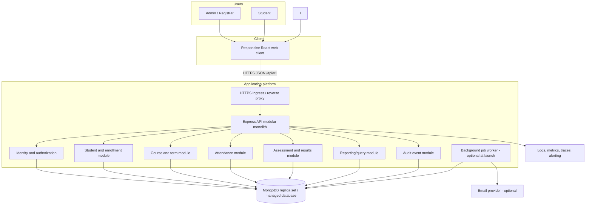
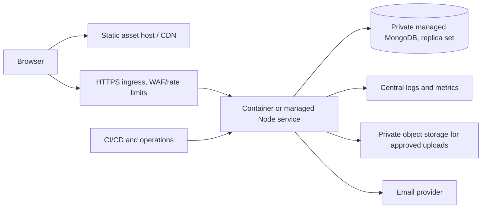
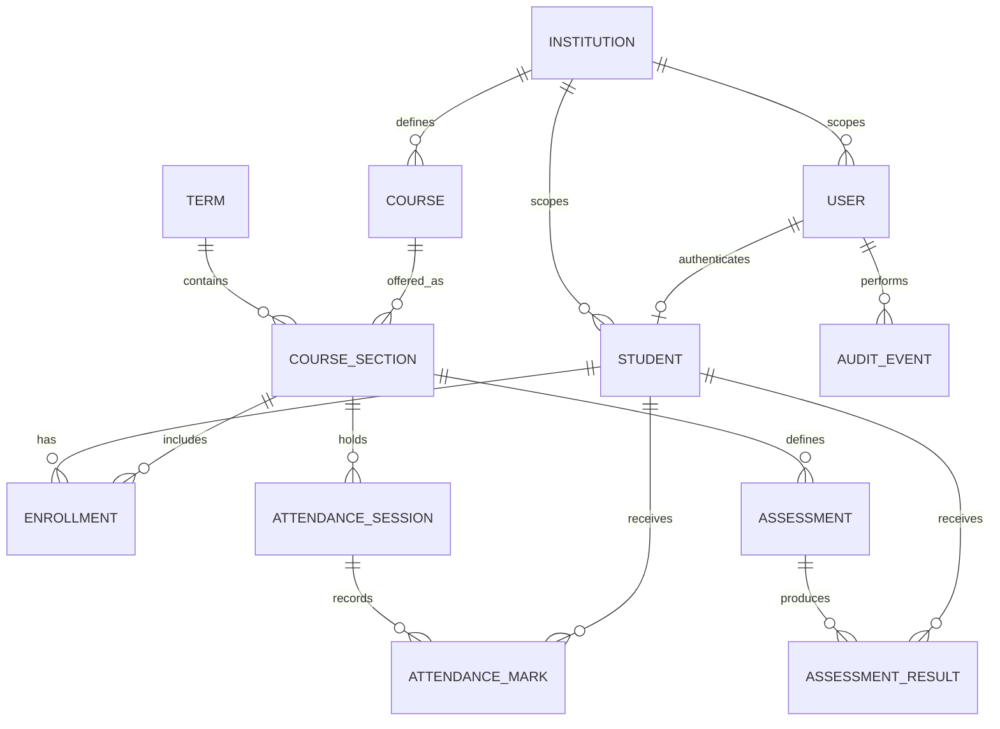

# Student Management System — Professional System Design

| Field | Value |
|---|---|
| Status | Architecture baseline — v1.0 draft for stakeholder review |
| Product | Student Management System (SMS) |
| Date | 2026-11-07 |
| Delivery approach | Agile, iterative, demonstrable increments |
| Current implementation context | React/Vite client, Express API, MongoDB/Mongoose server exist in the workspace; this design is the target architecture, not a claim that the current code already meets it. |

## 1. Executive overview

The SMS is a secure system of record for student identity, enrollment, attendance, assessments, results, and administrative reporting. Staff manage institutional records. Students can access only their own permitted information. The product begins as a modular monolith backed by a transactional-capable MongoDB deployment, with a browser-based responsive client and versioned REST API.

The design prioritizes data integrity, privacy, accessibility, auditability, maintainability, and a usable end-to-end release. It avoids premature microservices and makes deployment, multi-institution support, grading policies, and account provisioning explicit decisions before production implementation.

## 2. Product vision and outcomes

### Vision

Provide a dependable, easy-to-use platform that reduces fragmented student recordkeeping and gives authorized people timely, accurate academic information.

### Desired outcomes

- Staff can maintain a trustworthy student roster and enrollment history.
- Attendance and academic results are traceable to dates, courses, actors, and policy.
- Students can securely view their own profile, attendance, and released results.
- Administrators can answer routine operational questions without manually reconciling spreadsheets.
- The system can be maintained and extended by a small team without a costly distributed architecture.

### Product success measures (initial targets to validate)

- A staff user can create a student and enroll them in a course in under 3 minutes.
- A staff user can record a class attendance session with fewer than 2 minutes of repetitive entry for a typical class.
- 100% of student-facing data endpoints enforce record ownership server-side.
- 100% of changes to grades, attendance corrections, account status, and result publication are attributable to an actor and timestamp.
- Core list and detail screens have a p95 API response under 500 ms at the agreed launch scale, excluding external network latency.
- No unresolved critical or high severity security findings at production launch.

These are planning targets, not measured guarantees; validate scale and usability with stakeholders and representative data.

## 3. Stakeholders and actors

| Actor | Responsibilities and access |
|---|---|
| Institution owner / system owner | Policy decisions and operational oversight; uses an administrator account for application tasks. |
| Administrator / registrar | Student records, enrollment, courses/terms, account invitations, and operational reports. |
| Student | Own profile, attendance history, and published results. May request corrections through institution process. |
| Support/operator | Deployment, monitoring, backup, restore, and incident response; no application account or routine academic-record access. |

The application has exactly two login roles: `admin` and `student`. Administrators manage academic records and student accounts; students can access only their own permitted records. Instructor, auditor, owner, and support/operator login roles are out of scope. This role decision was confirmed by the product owner on 2026-11-08.

## 4. Scope and feature catalogue

### Platform and identity

- Institution settings, academic years/terms, timezone, locale, grading and attendance policy.
- Authentication, sign-out, session expiry, password recovery, student account invitation and activation/deactivation; administrator accounts are provisioned through the controlled setup process.
- Optional MFA for privileged accounts and SSO as later capabilities.
- Student-user profile linkage; one identity should not be duplicated to represent multiple course enrollments.

### Student information

- Student lifecycle: prospective (optional), active, on leave, graduated, withdrawn, archived.
- Stable student number, legal/preferred name, contact details, address and emergency contact only if policy requires them, admission date, status, and optional profile image.
- Search, filters, sort, pagination, import/export with permissions and audit trail.
- Duplicate detection and controlled merge/correction workflow; no silent destructive edits.
- Student profile history and enrollment history.

### Organization and academics

- Departments/programs (optional), courses/subjects, course sections/classes, terms/academic years, and room/timetable references if enabled.
- Enrollment and withdrawal with effective dates and status.
- Administrators manage course offerings and rosters.
- Configurable academic calendar and course roster.

### Attendance

- Attendance session by course section, date/time, and optional meeting period.
- Configurable marks, with a proposed baseline of `present`, `absent`, `late`, and `excused`.
- Bulk class marking, individual corrections, reason/comment where policy permits, and correction history.
- Duplicate session protection and attendance summaries with a clearly defined denominator and excused-absence policy.
- Student view of their own history and summary.

### Assessments and results

- Assessment definition: title, type, course section, maximum score, weight (optional), dates, status, and grading policy.
- Grade entry, validation, moderation/review (optional), feedback, missing/incomplete state, and correction history.
- Draft versus published results; students see only released results.
- Result calculations must use a versioned policy and transparent rounding rules. Never hard-code one global weighted average as an assumed institutional rule.
- Reopen/revise a published result only through a permissioned, audited operation.

### Dashboard and reporting

- Role-specific dashboard and operational alerts (e.g., attendance not submitted, incomplete grading).
- Roster, enrollment, attendance, and performance reports with date/course filters.
- Aggregates must identify their source window, timezone, calculation policy, and last refresh time.
- Exports have explicit permission checks, minimal fields, audit events, and safe handling of downloaded files.

### Communications and optional modules

- Notification preferences and in-app notices; SMTP is the selected email transport for student account links. Email delivery must use institution-approved sender infrastructure and privacy review; SMS is outside the initial scope.
- Parent/guardian portal, fee management, timetable, library, transport, online exams, certificates, and mobile apps are future modules, not implicit MVP scope.

## 5. Non-goals for the initial release

- Microservices, event streaming, multi-region active-active operation, or a data warehouse.
- Automated high-stakes decisions about student progression or eligibility.
- Payments, financial ledgers, or fee collection.
- Public student directories or anonymous access to records.
- Storing unnecessary sensitive data such as government identifiers without a documented legal and operational need.

## 6. Assumptions and decisions to settle

The architecture below is designed to support a single institution initially and to add institution scoping without rewriting every module. The default is a hosted responsive web app. MongoDB is retained to align with the existing code. These are provisional defaults, not confirmed business requirements.

| Decision | Recommended initial default | Why it matters |
|---|---|---|
| Institution model | Single institution at launch; include `institutionId` on tenant-owned records from the beginning if multi-school support is plausible. | Tenant boundaries affect every query, unique index, report, and authorization check. |
| Account provisioning | Staff invite students; self-registration is disabled unless institution policy requires it. | Prevents unverified accounts and orphan profiles. |
| Attendance states | Present, absent, late, excused; define whether late counts as present and treatment of excused days. | Drives reliable percentage calculations. |
| Grading | Configurable per institution/course; numeric points initially, with optional letter/grade bands later. | Weighting, scaling, rounding, and retakes vary. |
| Result release | Results remain draft until authorized staff publish them. | Avoids exposing incomplete or unreviewed marks. |
| Launch mode | Hosted web application; desktop packaging is a separate delivery option. | Existing Electron shell may affect local API configuration and update strategy. |
| Data retention | Institution-defined schedule and archival process. | Student records may be subject to contractual and jurisdictional requirements. |
| Expected scale | Establish a launch estimate for institutions, users, students, peak concurrency, and retention before capacity planning. | Required for infrastructure sizing and performance commitments. |

## 7. Architecture principles

1. **Modular monolith first:** one deployable API with explicit bounded modules and internal interfaces; extract services only when independent scaling, ownership, or reliability evidence justifies it.
2. **Server is authoritative:** the client presents permissions but never grants them. Validate and authorize every request at the API boundary and again at resource/service boundaries where appropriate.
3. **Least privilege and deny by default:** roles and resource ownership are explicit; new routes have no access until policy is defined.
4. **Privacy by design:** collect the minimum required data, restrict sensitive fields, set retention rules, and avoid sensitive values in logs and analytics.
5. **Data integrity over convenience:** use validation, unique constraints, transactional boundaries where needed, immutable audit events, and explicit correction flows.
6. **Domain source of truth:** attendance sessions and assessment results are the source records; dashboard percentages and summaries are derived, never manually editable truth.
7. **API contracts before parallel implementation:** document request/response schemas, validation errors, pagination, authorization, and versioning.
8. **Secure defaults:** HTTPS, safe session handling, restrictive CORS, security headers, rate limits, secret management, dependency updates, and controlled exports.
9. **Observable operation:** structured logs, request correlation IDs, metrics, health/readiness endpoints, audit trail, and actionable alerts.
10. **Accessible and resilient UX:** keyboard access, labels, contrast, responsive layout, clear validation, safe retry behavior, and useful empty/error/loading states.
11. **Reversible change:** schema evolution uses additive migrations/backfills, feature flags for risky rollouts, and documented restore/rollback procedures.
12. **Measure before optimizing:** define representative workloads; add indexes and caches based on query evidence, not guesswork.

## 8. Context and container architecture

### Deployment view

Keep the database private to the application network. Separate development, staging, and production environments and credentials. Production deployments use TLS, managed backups, access-controlled secrets, and a documented restoration drill. If the app is packaged in Electron for offline/local use, treat it as a separate deployment profile: localhost API assumptions, data protection, updates, backup, and multi-user access must be redesigned explicitly.

## 9. Logical module boundaries

| Module | Owns | Main responsibilities |
|---|---|---|
| Identity & access | Users, roles, sessions/invitations | Authentication, account lifecycle, authorization policy, recovery and privileged access. |
| Institution & policy | Institution, academic calendar, policy versions | Timezone, terms, attendance and grading configurations. |
| Student records | Student profiles, identifiers, status | Profile lifecycle, deduplication, search, exports. |
| Academic structure | Programs, courses, sections | Terms, rosters, course ownership by administrators. |
| Enrollment | Student-course-term relationships | Enrollment lifecycle and effective dates. |
| Attendance | Sessions and marks | Bulk entry, correction workflow, summary calculation. |
| Assessment & results | Assessments, results, release state | Grade entry, policy calculations, result publication. |
| Reporting | Read models and report queries | Aggregation, filters, export preparation. |
| Audit | Append-only domain audit events | Who changed what, when, on which entity, and why where required. |
| Notifications | Notification requests and preferences | Optional email/in-app notifications with delivery tracking. |

Modules expose application services and schemas, not direct access to each other's collections from UI handlers. Cross-module actions use service interfaces and, where atomicity is required, a transaction with a defined boundary.

## 10. Domain model and data ownership

### Entity catalogue

| Entity | Core fields (illustrative) | Invariants |
|---|---|---|
| Institution | `id`, `name`, `timezone`, `locale`, `status`, policy references | Tenant-scoped data always belongs to exactly one institution. |
| User | `id`, normalized `email`, `passwordHash`, `role` (`admin` or `student`), `status`, timestamps | Unique email; role is limited to the two approved values; secrets never serialized. |
| Student | `id`, `institutionId`, `userId?`, `studentNumber`, names, minimal contact fields, lifecycle status | Student number unique within institution; account linkage is optional until provisioned. |
| Term | `id`, `institutionId`, `name`, `startDate`, `endDate`, `status` | Valid date range; no ambiguous active term per configured policy. |
| Course | `id`, `institutionId`, `code`, `name`, `status` | Course code unique within institution where policy requires. |
| CourseSection | `id`, `courseId`, `termId`, `sectionCode`, capacity?, status | Course and term belong to same institution. |
| Enrollment | `studentId`, `sectionId`, status, effective dates | At most one active enrollment per student/section; history retained. |
| AttendanceSession | `sectionId`, local date/time, session key, status, recordedBy, finalizedAt | Unique section/session key; finalized sessions require correction flow. |
| AttendanceMark | `sessionId`, `studentId`, attendanceStatus, reason?, recordedBy | Unique student per session; student must be enrolled in the section. |
| Assessment | `sectionId`, title, type, maxScore, weight?, dueAt?, status, policyVersion | Score bounds and weight totals validated per grading policy. |
| AssessmentResult | `assessmentId`, `studentId`, score/state, feedback?, gradedBy, version, publishedAt? | One current result per student/assessment plus auditable revision history. |
| AuditEvent | actor, institution, action, entity type/id, timestamp, request ID, changed-field summary, reason? | Append-only; exclude passwords, tokens, and unnecessary personal data. |
| FileAsset (optional) | owner entity, private object key, MIME, size, checksum, lifecycle | Private access, content-type/size validation, retention and malware scan policy. |

Implementation note: this single-institution prototype now accepts an optional student number, stores it trimmed and uppercase, and enforces global uniqueness with a sparse index. Before enabling multiple institutions, scope this index and every student-number lookup to `institutionId`.

Implementation note: student password recovery is administrator-issued only. Staff verify identity through the institution's approved channel, then share a 30-minute one-time reset link; public endpoints return no account lookup result without that token.

Implementation note: student activation and administrator-issued password-reset links are sent over configured SMTP using STARTTLS or implicit TLS. Token hashes are stored on invitation/reset records. SMTP-enabled deployments also configure a separate base64 32-byte `EMAIL_OUTBOX_ENCRYPTION_KEY`; the transactional outbox stores link payloads only as AES-256-GCM ciphertext bound to the outbox ID and message type. A leased worker makes up to 10 delivery attempts with bounded exponential backoff, drops expired or superseded links, and removes ciphertext after delivery or terminal failure. Delivery is at-least-once because a process crash after SMTP acceptance but before the success write can cause duplicate mail. Non-production can use the admin-only copy-link fallback when SMTP is not configured.

Store timestamps in UTC and apply institution timezone only for calendar boundaries and display. For date-only attendance, preserve the institution-local calendar date explicitly to avoid UTC boundary shifts. Add `createdAt`, `updatedAt`, and appropriate actor references to mutable domain entities. Use soft deactivation/archive for records referenced by history; do not cascade-delete academic history.

### MongoDB guidance

- Use a replica set in environments requiring multi-document transactions; production managed clusters should enable appropriate durability and backups.
- Prefer references for high-cardinality histories (attendance, results, audit), not unbounded arrays embedded in a student document.
- Add compound indexes based on access patterns, such as `(institutionId, studentNumber)`, `(institutionId, normalizedEmail)`, `(sectionId, localDate)`, `(studentId, sessionId)`, `(studentId, status)`, and `(assessmentId, studentId)`.
- Ensure tenant identifiers participate in unique indexes in multi-institution mode.
- Validate schemas at both API and database/model boundaries. Introduce schema changes additively and backfill before enforcing new required fields.
- Do not store derived attendance percentage or final GPA as the authoritative record; compute from policy-versioned records, optionally caching a rebuildable summary.

## 11. API design

### Contract standards

- Base path `/api/v1`; HTTPS only outside local development.
- JSON, UTF-8, ISO-8601 timestamps; date-only values use `YYYY-MM-DD` and documented institution timezone semantics.
- Consistent envelope for list responses: `{ "data": [], "page": { "nextCursor": null }, "meta": {} }`.
- Consistent errors: `{ "error": { "code": "VALIDATION_ERROR", "message": "...", "fields": {}, "requestId": "..." } }`.
- Cursor pagination for large or changing collections; bounded page size and deterministic sort.
- Use `PATCH` for partial updates, idempotency keys for retryable bulk writes where practical, and explicit status transitions for publish/finalize operations.
- Generate and review an OpenAPI contract; reject unknown or malformed inputs rather than silently accepting unexpected fields.

### API surface (initial)

| Area | Endpoint examples | Access and rules |
|---|---|---|
| Authentication | `POST /auth/login`, `POST /auth/logout`, `POST /auth/refresh` (if refresh-token design chosen), `GET /auth/me`, `POST /auth/invitations/accept` | Rate-limited; never return password data; session policy documented. |
| Users | `POST /students/:id/invitation`, `POST /students/:id/password-reset`, account-status actions | Administrator only; student activation is invitation-based; administrator provisioning remains a controlled setup task. |
| Students | `GET /students`, `POST /students`, `GET /students/:id`, `PATCH /students/:id`, `POST /students/:id/archive` | Administrator only; students use self-service endpoints for their own records. |
| Terms/courses | `GET/POST /terms`, `GET/POST /courses`, `GET/POST /course-sections` | Administrator only; no instructor-scoped access. |
| Enrollment | `GET /enrollments`, `POST /enrollments`, `PATCH /enrollments/:id/status` | Validate student, section, term consistency; retain history. |
| Attendance | `POST /course-sections/:id/attendance-sessions`, `PUT /attendance-sessions/:id/marks`, `POST /attendance-sessions/:id/finalize`, `POST /attendance-sessions/:id/corrections`, `GET /students/me/attendance` | Administrator manages records; students can view only their own finalized attendance. |
| Assessments | `POST /course-sections/:id/assessments`, `PATCH /assessments/:id`, `PUT /assessments/:id/results`, `POST /assessments/:id/publish` | Administrator manages assessments and results; students see only their own published results. |
| Student views | `GET /students/me`, `GET /students/me/enrollments`, `GET /students/me/results` | Enforce identity-to-student mapping on server; results only when published. |
| Reporting | `GET /reports/roster`, `GET /reports/attendance`, `GET /reports/performance` | Field-level permission, bounded date ranges, audited exports. |
| Operations | `GET /health/live`, `GET /health/ready` | Minimal public liveness; readiness may be network-restricted and disclose no secrets. |

Never trust a client-supplied `studentId`, `institutionId`, role, or `recordedBy` as proof of authority. Derive actor and student ownership from the authenticated principal; enforce only `admin` and `student` roles.

## 12. Authentication, authorization, and privacy

### Authentication

- Use a proven password hashing library with a modern adaptive hash (Argon2id preferred where runtime support permits; otherwise an appropriately configured bcrypt implementation). Never encrypt passwords for later recovery.
- For browser sessions, prefer secure, HttpOnly, SameSite cookies with CSRF protection when using cookies. If bearer tokens are used, define short access-token lifetime, rotation/revocation strategy, and avoid persistent browser storage for long-lived secrets.
- Rate-limit login and recovery flows; use generic authentication failure messages; verify email/invitation ownership before activation.
- Require MFA for privileged roles if operationally supported; document account recovery separately from normal login.
- Store secrets in a managed secret store or protected environment configuration, rotate on a schedule and after exposure, and separate environments.

### Authorization

- Role authorization is limited to administrator capabilities and a student's own profile and academic records.
- Centralize policy checks and write deny-by-default tests for every protected endpoint.
- Avoid broad `admin` bypass for support accounts; support access should be time-bound, logged, and least-privilege.
- Apply field-level restrictions to sensitive contact details and exports.

### Privacy and threat controls

- Maintain a data inventory, purpose, retention rule, and access role for every personal field.
- TLS in transit; encrypted managed storage and backups at rest; private database network access.
- Security headers, restrictive CORS allowlist, request body limits, dependency scanning, and protection against injection, XSS, CSRF (as applicable), IDOR/BOLA, brute force, and unsafe file uploads.
- Sanitize/encode user content on rendering; never render arbitrary HTML from comments/feedback.
- Redact credentials, tokens, student details, and request bodies from logs. Keep audit data separate from operational debug logs.
- Define incident response, access review, retention, deletion/anonymization, and breach notification process according to the institution's applicable jurisdiction and policy. No jurisdiction-specific compliance claim is made in this design.

## 13. Quality attributes and service objectives

| Attribute | Initial design target |
|---|---|
| Availability | Define launch target with owner; provisional hosted target 99.5% monthly excluding announced maintenance. |
| Performance | p95 below 500 ms for common API reads at agreed launch load; heavy reports are bounded or asynchronous. |
| Scalability | Scale API instances horizontally; database indexes and query limits; capacity based on validated user and data volumes. |
| Durability | Managed database backups, point-in-time recovery where available, and tested restore runbook. |
| Recovery | Set RPO/RTO with institution owner; provisional planning values: RPO ≤ 24 hours, RTO ≤ 8 hours, then tighten based on impact and cost. |
| Security | Threat model, role/ownership review, dependency and secret scans, audit for critical changes, incident runbook. |
| Accessibility | Target WCAG 2.2 AA for key user journeys; verify keyboard operation, semantic labels, contrast, and screen-reader flows. |
| Compatibility | Current supported major browsers and responsive tablet/mobile viewport; publish support policy. |
| Maintainability | Modular code boundaries, API schema, automated checks, code review, migration/runbook documentation. |
| Localization | Institution-configured timezone and locale; avoid hard-coded date and number formatting. |

Targets are proposed starting points and require product owner approval and operational validation before service commitments.

## 14. User experience architecture

- React application organized by role and feature, with shared design system, form components, route guards, and a single typed/validated API client.
- Route guards improve navigation only; API authorization remains authoritative.
- Use server-driven pagination and filtering for student rosters; debounce search and preserve filter state where useful.
- Show explicit save status, field-level validation, loading, empty, error, offline/network-failure, and permission-denied states.
- Warn before leaving unsaved forms; use idempotent/retry-safe behavior for bulk attendance and grade saves.
- Responsive layouts, keyboard-first controls, visible focus, accessible dialogs/tables, and confirmation for meaningful destructive or publish/finalize operations.
- Do not expose internal error stack traces or technical database messages to users.

## 15. Deployment, environments, and delivery pipeline

### Environments

- **Local:** synthetic seed data; no production secrets or copied student data.
- **CI:** lint/build/schema checks and automated unit/integration/security checks using isolated services/data.
- **Staging:** production-like configuration, synthetic or anonymized data, migration rehearsal, stakeholder acceptance.
- **Production:** private database, managed secrets, backups, controlled admin access, monitoring, and documented rollback/restore.

### CI/CD gates

1. Formatting/lint, type/schema validation, and build.
2. Unit tests for domain policy and calculations.
3. API integration tests for validation, authorization/ownership, and persistence.
4. Dependency/secret/static security scans.
5. Migration compatibility and staging smoke checks.
6. Human review for production promotion and monitored rollout.

Deploy additive schema changes before dependent app changes. Use backward-compatible API evolution within v1; introduce `/v2` only for incompatible contracts with a deprecation window.

## 16. Observability and operations

- Structured JSON logs include timestamp, level, service, environment, request ID, route template, duration, and safe error code; avoid raw PII.
- Metrics include request rate/error rate/latency, database health/latency, auth throttling, job queue depth, and attendance/grade workflow failures.
- Distributed tracing may be added if multiple services or external calls make diagnosis difficult; not required on day one.
- Alerts should focus on user impact: elevated server errors, database unavailable, backup failure, unusual auth activity, and queue backlog.
- Health endpoints distinguish process liveness from dependency readiness and reveal no credentials or database URI.
- Runbooks cover deploy/rollback, backup/restore, credential rotation, incident triage, and user support escalation.
- Audit events record important domain actions independently of logs; restrict access and retention.

## 17. Failure modes and resilience

| Failure | Behavior |
|---|---|
| Database unavailable | Readiness fails; API returns safe retryable errors; do not report writes as successful. Alert operator. |
| Duplicate attendance submission | Enforce unique keys/idempotency; return current state or conflict safely, without double counting. |
| Network interruption during bulk save | Client shows uncertain state and allows safe retry; backend operation is idempotent or reports per-row outcomes. |
| Email provider unavailable | Core student record workflows continue; queue retryable invitations/notifications and expose delivery status. |
| Invalid/stale token | Return a consistent unauthorized response; client clears invalid session and prompts for login. |
| Partial import failure | Validate preview first; return row-level results; commit atomically where feasible or provide explicit resumable batch semantics. |
| Corrupt or accidental data change | Use audit/revision history and tested database restore; provide controlled correction workflow. |

## 18. Agile delivery plan

Use a prioritized product backlog. Each story has a user, outcome, acceptance criteria, role/security rules, data effects, and demo path. Sprint length can be one or two weeks; choose with the team. At each review, incorporate stakeholder feedback and re-prioritize.

### Discovery / Sprint 0

- Agree institution model, roles, workflow policies, grading/attendance rules, account provisioning, launch mode, data retention, and expected scale.
- Map current spreadsheets/processes and migration quality; classify sensitive fields.
- Validate initial user journeys with administrator and student representatives.
- Approve architecture decisions and define Definition of Ready/Done.

### Increment 1 — secure foundation and student lifecycle

- Environment/configuration, health/readiness, request validation, API error contract, auth/session, role and ownership policy.
- Admin invites/creates a student, views/searches/updates/archives profile; student can sign in and see own profile.
- Acceptance: unauthorized or cross-student reads/writes are rejected by API; change actor/time is auditable; usable loading/error/empty states.

### Increment 2 — terms, courses, sections, enrollment

- Configure term/course/section; enroll and withdraw students with history.
- Acceptance: roster reflects active enrollment and all cross-institution/invalid relationships are rejected.

### Increment 3 — attendance

- Create sessions, mark a roster, finalize, correct with reason; student view and policy-based summary.
- Acceptance: duplicate submission does not double count; corrections retain prior value and actor history; summary rules are visible.

### Increment 4 — assessments and results

- Assessment creation, grade entry, validation, revision history, draft/release workflow, student results view.
- Acceptance: only published results are visible to students; unpublished and other-student records are inaccessible.

### Increment 5 — reporting and launch readiness

- Operational reports, constrained exports, dashboard summaries, accessibility review, performance baseline, security review, restore drill, production runbooks.
- Acceptance: report calculations reconcile to source records and operational recovery objectives are demonstrated.

### Definition of Done

- Acceptance criteria met and demonstrated on staging.
- API authorization and input validation implemented server-side.
- Appropriate automated checks pass; accessibility and error states considered.
- Audit, logs, and privacy behavior reviewed for affected data.
- API/schema documentation and operational notes updated.
- No unresolved critical/high severity issue introduced; migration and rollback plan exists where needed.

## 19. Risks and mitigations

| Risk | Impact | Mitigation |
|---|---|---|
| Requirements/policy differ by institution | Rework and incorrect attendance/grade reports | Confirm policy ownership; make rules configurable and versioned, not implicit. |
| Cross-student or cross-institution data exposure | High privacy harm | Central policy enforcement, tenant-scoped queries, negative authorization tests, and security review. |
| Poor legacy data quality | Incorrect records and slow onboarding | Profile source data, import preview, validation, duplicate reporting, reversible batch process. |
| Ambiguous account-to-student matching | Account takeover or orphan accounts | Invitation flow and verified linkage; never link by unverified client email alone. |
| Derived totals disagree with source data | Loss of trust | Document formulas, version policy, reconcile summaries, and make summaries rebuildable. |
| Accidental grade/attendance overwrite | Academic dispute | Revision/audit history, finalize/publish workflow, correction reason, and restricted permissions. |
| Unclear hosting/desktop expectations | Wrong auth, networking, and update design | Set deployment target before implementation; treat Electron as a distinct deployment architecture. |
| Scope growth before usable release | Delayed feedback | Protect an end-to-end MVP and prioritize features through sprint review. |

## 20. Architecture decision records (initial)

### ADR-001: Modular monolith for launch

- **Decision:** React client + one modular Express API + MongoDB; keep module boundaries explicit.
- **Reason:** Fits current team/project and delivers a coherent system with simpler deployment and transaction boundaries.
- **Trade-off:** API modules deploy and scale together until evidence supports extraction.
- **Revisit when:** independent team ownership, resource scaling, or isolation requirements become measurable.

### ADR-002: Preserve history; derive academic summaries

- **Decision:** Attendance sessions/marks and assessment/results are separate dated records; percentages and aggregates are derived under explicit policies.
- **Reason:** Supports correction, auditability, and changing academic rules.
- **Trade-off:** More queries and policy/version design than a few summary fields.

### ADR-003: Versioned REST API

- **Decision:** Use documented JSON REST under `/api/v1`.
- **Reason:** Familiar for browser clients and fits the current Express codebase.
- **Trade-off:** Requires contract discipline and controlled evolution.

### ADR-004: Institution boundary is a discovery gate

- **Decision:** Do not claim multi-tenancy as solved until institution scope, indexes, authorization, imports, exports, and operational boundaries are confirmed and tested.
- **Reason:** Tenant isolation is a security property spanning all layers.

## 21. Existing code alignment and migration notes

The workspace currently contains a React/Vite frontend and Express/Mongoose API, login with `admin`/`student`, and a student document with course, batch, attendance percentage, and score fields. This is a useful prototype base, but it does not yet implement the target domain model or the full controls in this document.

Before evolving the code:

1. Inventory current routes, data, dependencies, secrets, and expected run/deploy modes; never commit the existing `.env`.
2. Keep existing student records and take a verified backup before any migration.
3. Review the read-only legacy course/batch inventory, map each pair to an approved course offering, then run the resumable enrollment migration with the API stopped. The migration preserves legacy attendance and score snapshots and does not invent dated records.
4. Replace client-trusted role assumptions with server authorization and explicit account provisioning.
5. Replace editable scalar attendance/score summaries with dated records and documented calculation policies.
6. Separate environment configuration, add API contract and observability foundations, and remove demo/test credentials from source.

This design artifact itself did not migrate application records. An explicit data migration command is now available in the implementation progress below; operators must still review its dry-run report, provide approved course/term/section mappings, and apply it against the intended database.

### Current implementation progress (2026-11-08)

This is an incremental implementation snapshot. The target design above remains the source of truth for architecture intent; the following items are implemented in the current React/Vite + Express/MongoDB codebase, but have not all been operationally validated against a live replica-set database:

- The application is a modular monolith with role-protected student and academic APIs, cookie-based sessions, account activation invitations, student lifecycle operations, attendance, assessments, audit events, CSV reports, and explicit MongoDB index installation.
- Session JWTs are now signed explicitly with HS256 and verification rejects tokens that use any other algorithm.
- Profile photos can now be explicitly uploaded to and removed from the signed-in account. The client resizes them and the server accepts only bounded JPEG data, excludes the field from ordinary user queries, and serves it through a private authenticated endpoint. Old browser-only photos are not migrated automatically.
- Requests receive a correlation ID; unexpected errors return it to the caller and emit a structured log record with route context and no request body.
- Authentication uses the server's HttpOnly cookie as the only credential; the frontend keeps a non-secret session marker in memory rather than browser storage. On a protected API `401`, it clears that marker, returns to sign-in, and clears the stale cookie; anonymous login/session-check responses do not trigger the session-expired flow.
- New logical backups use a compressed AES-256-GCM archive and SHA-256 checksum. The key is configured separately from backup files, v1 backups remain readable, and restore continues to require an empty target database.
- A legacy academic migration command inventories existing course/batch groups without writing, requires an explicit reviewed offering mapping for every group, creates mapped course offerings, and adds only missing active enrollments in bounded MongoDB transactions. A migration ledger locks the mapping hash for safe resume; old attendance and score snapshots remain untouched. The live migration has not been run or verified against the institution's database.
- The admin dashboard includes a first-run checklist for the first student record, course offering, and enrollment. Completion is based on live summary counts, and actions navigate to the relevant management workflow.
- Student password recovery is administrator-issued after identity verification through an institution-approved channel. The opaque one-time token is stored only as a SHA-256 hash, expires in 30 minutes, is returned only to the issuing admin, and is never included in audit events. Completion revokes existing sessions and invalidates sibling reset links.
- Activation and password-reset emails use the selected SMTP transport and transactional outbox; production requires SMTP host/sender/TLS configuration plus a separately managed outbox encryption key. SMTP credentials and the outbox key belong in the secret manager. Identity verification is confirmed in the admin UI before a reset is issued. Delivery status is persisted; live SMTP acceptance remains unverified.
- Reset-token inspection and completion use the existing IP-bound authentication rate limiter. Public endpoints do not accept an email address or reveal whether an account exists.
- The API is now mounted at `/api/v1`; `/api` remains available as a compatibility alias and marks responses with `X-API-Deprecated: true`. New clients should use the versioned base path.
- A reviewed OpenAPI 3.1 catalog now documents the versioned auth, student, attendance, assessment, enrollment, reporting, and audit routes in `server-old/server/openapi.yaml`. It is intentionally not described as generated or automatically enforced at runtime yet.
- The OpenAPI catalog is available without authentication at `/api/v1/openapi.yaml`, with caching disabled so API consumers can retrieve the current reviewed contract.
- Multi-institution tenancy, configurable attendance and grading policy, execution of the reviewed data migration, automated CI/security gates, and production operations remain release work. Instructor, auditor, and support login roles are excluded from the approved role model. Do not represent the current prototype as production-ready until the stakeholder checklist and operational validation are complete.

Local verification to date includes JavaScript syntax checks and a Vite production build. The local MongoDB service was unavailable during the latest implementation pass, so transaction behavior, index installation, and database-backed acceptance flows remain unverified in this environment.

## 22. Review checklist for stakeholder sign-off

- [ ] Single institution or multi-institution at launch?
- [x] Final roles: admin manages institutional records and accounts; student accesses only their own permitted data. No instructor, auditor, or support login role.
- [ ] Who creates accounts and links them to student profiles?
- [ ] Official attendance states, session rules, and summary formula?
- [ ] Grading scales, weights, rounding, retakes, and result release workflow?
- [ ] Required student fields, sensitive fields, and data retention policy?
- [ ] Import/export scope and authorized users?
- [ ] Hosted web, local desktop, or both? Expected scale and availability target?
- [ ] Applicable privacy/security obligations and operational owner?
- [ ] RPO/RTO, backup retention, and support process?
